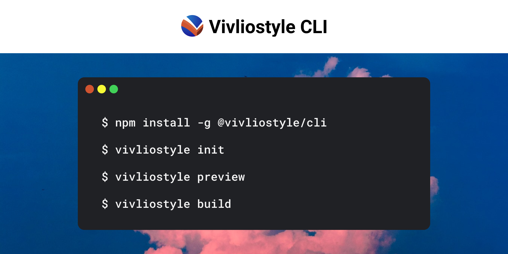

> [!NOTE]
> **このリポジトリは、公式の [Vivliostyle CLI](https://github.com/vivliostyle/vivliostyle-cli) の個人用フォークです。**
> This is a personal fork of the official [Vivliostyle CLI](https://github.com/vivliostyle/vivliostyle-cli). For the official releases and documentation, see the official repository and [docs.vivliostyle.org](https://docs.vivliostyle.org).
>
> 公式との主な違い:
>
> - **大きな本の並列ビルド**(既定で有効、実験的): 本をパートに分けて並列のプロセスで組版し、PDF を結合します。ページ番号、目次、しおり、リンクは、本全体を組版した場合と同じになります。[docs/parallel-build.md](docs/parallel-build.md)
> - **コンパイルキャッシュ**(`compileCache`、オプトイン、実験的): 変更のない原稿は HTML への変換を省きます。[docs/compile-cache.md](docs/compile-cache.md)
> - ビューアの完了待ちの短縮など、ビルドの固定コストの削減。
> - テーマが参照するファイルのコピー漏れの修正、エントリーコンテキストの外への `@import` のエラー化など。
>
> 計測に使った 169 ページの本(表紙・目次つき)では、公式の 34.0 秒に対して、並列ビルドで 13.3 秒、コンパイルキャッシュも使うと 11.5 秒でした。出力は、公式と全ページがピクセル単位で一致しています。
>
> このフォークは、公式の `vivliostyle` コマンドと併用するため、`vn` コマンドとして使っています(ビルドして `dist/cli.js` へのシンボリックリンクを置きます)。
>
> ```sh
> pnpm install && pnpm build:cli
> ln -s "$PWD/dist/cli.js" /usr/local/bin/vn
> ```
>
> 公式にない機能と修正の一覧は [docs/fork-features.md](docs/fork-features.md) にあります。
>
> 公式へのプルリクエストは予定していません。生成 AI の利用については [AI_POLICY.md](AI_POLICY.md) に従い、コミットに `Assisted-by` を記載しています。
> 組版エンジンのフォークは [AyumuTakai/vivliostyle.js](https://github.com/AyumuTakai/vivliostyle.js) です。



[][npm-url]
[][npm-url]

[npm-url]: https://npmjs.org/package/@vivliostyle/cli

<div align="center">
  <b>Supercharge your command-line publication workflow.</b>
</div>

# Vivliostyle CLI

## Install

```
npm install -g @vivliostyle/cli
```

## User Guide

See [User Guide](https://github.com/vivliostyle/vivliostyle-cli/tree/HEAD/docs#readme)

## Use

```
Usage: vivliostyle [options] [command]

Options:
  -v, --version   output the version number
  -h, --help      display help for command

Commands:
  create          Scaffold a new Vivliostyle project
  init            Create a Vivliostyle configuration file
  build           Create PDF, EPUB, and other publication files
  preview         Open the preview page and interactively save PDFs
  theme           Create and validate Vivliostyle theme packages
  help [command]  display help for command
```

### `create`

> Scaffold a new Vivliostyle project

You are new to Vivliostyle? Check out our [Create Book](https://github.com/vivliostyle/vivliostyle-cli/tree/HEAD/packages/create-book#readme) project.
With Create Book, you can easily bootstrap your book project and start writing without any extra effort.

<details>
<summary><b>Full CLI options</b></summary>

```
Usage: vivliostyle create [options] [projectPath]

scaffold a new Vivliostyle project

Options:
  --title <title>               title
  --author <author>             author
  -l, --language <language>     language
  -s, --size <size>             paper size
  -T, --theme <theme>           theme
  --no-theme                    Do not include a theme.
  --template <template>         Template source in the format of `[provider]:repo[/subpath][#ref]` or as a local directory to copy from.
  --install-dependencies        Install dependencies after creating a project.
  --no-install-dependencies     Do not install dependencies after creating a project.
  --create-config-file-only     Create a Vivliostyle config file without generating project template files.
  --proxy-server <proxyServer>  HTTP/SOCK proxy server url
  --proxy-bypass <proxyBypass>  optional comma-separated domains to bypass proxy
  --proxy-user <proxyUser>      optional username for HTTP proxy authentication
  --proxy-pass <proxyPass>      optional password for HTTP proxy authentication
  --log-level <level>           specify a log level of console outputs (choices: "silent", "info", "verbose", "debug", default: "info")
  -v, --version                 output the version number
  -h, --help                    display help for command
```

</details>

### `init`

> Create a Vivliostyle configuration file

<details>
<summary><b>Full CLI options</b></summary>

```
Usage: vivliostyle init [options]

create vivliostyle config file

Options:
  --title <title>            title
  --author <author>          author
  -l, --language <language>  language
  -s, --size <size>          paper size
  -T, --theme <theme>        theme
  --log-level <level>        specify a log level of console outputs (choices: "silent", "info", "verbose", "debug", default: "info")
  -v, --version              output the version number
  -h, --help                 display help for command
```

</details>

### `build`

> Create PDF, EPUB, and other publication files

<details>
<summary><b>Full CLI options</b></summary>

```
Usage: vivliostyle build [options] [input]

build and create PDF file

Options:
  -c, --config <config_file>         path to vivliostyle.config.js [vivliostyle.config.js]
  -o, --output <path>                specify output file name or directory [<title>.pdf]
                                     This option can be specified multiple, then each -o options can be supplied one -f option.
                                     ex: -o output1 -f webpub -o output2.pdf -f pdf
  -f, --format <format>              specify output format corresponding output target
                                     If an extension is specified on -o option, this field will be inferenced automatically.
  -s, --size <size>                  output pdf size
                                     preset: A5, A4, A3, B5, B4, JIS-B5, JIS-B4, letter, legal, ledger
                                     custom(comma separated): 182mm,257mm or 8.5in,11in
  -m, --crop-marks                   print crop marks
  --bleed <bleed>                    extent of the bleed area for printing with crop marks [3mm]
  --crop-offset <offset>             distance between the edge of the trim size and the edge of the media size. [auto (13mm + bleed)]
  --css <CSS>                        custom style CSS code. (ex: ":root {--my-color: lime;}")
  --style <stylesheet>               Additional stylesheet for Vivliostyle viewer.
  --user-style <user_stylesheet>     Additional user stylesheet for Vivliostyle viewer.
  -d, --single-doc                   single HTML document input
  -p, --press-ready                  make generated PDF compatible with press ready PDF/X-1a [false]
                                     This option is equivalent with "--preflight press-ready"
  -t, --timeout <seconds>            timeout limit for waiting Vivliostyle process [300]
  -T, --theme <theme...>             theme path or package name
  --title <title>                    title
  --author <author>                  author
  -l, --language <language>          language
  --reading-progression <direction>  Direction of reading progression (choices: "ltr", "rtl")
  --render-mode <mode>               if docker is set, Vivliostyle try to render PDF on Docker container [local] (choices: "local", "docker")
  --preflight <mode>                 apply the process to generate PDF for printing (choices: "press-ready", "press-ready-local")
  --preflight-option <options...>    options for preflight process (ex: gray-scale, enforce-outline)
                                     Please refer the document of press-ready for further information.
                                     https://github.com/vibranthq/press-ready
  --executable-browser <path>        specify a path of executable browser you installed
  --image <image>                    specify a docker image to render
  --viewer <URL>                     specify a URL of displaying viewer instead of vivliostyle-cli's one
                                     It is useful that using own viewer that has staging features. (ex: https://vivliostyle.vercel.app/)
  --viewer-param <parameters>        specify viewer parameters. (ex: "allowScripts=false&pixelRatio=16")
  --browser <browser>                Specify a browser type and version to launch the Vivliostyle viewer (ex: chrome@129, firefox) [chrome]
  --proxy-server <proxyServer>       HTTP/SOCK proxy server url for underlying Playwright
  --proxy-bypass <proxyBypass>       optional comma-separated domains to bypass proxy
  --proxy-user <proxyUser>           optional username for HTTP proxy authentication
  --proxy-pass <proxyPass>           optional password for HTTP proxy authentication
  --log-level <level>                specify a log level of console outputs (choices: "silent", "info", "verbose", "debug", default: "info")
  --ignore-https-errors              true to ignore HTTPS errors when Playwright browser opens a new page
  --host <host>                      IP address the server should listen on
  --port <port>                      port the server should listen on
  --no-enable-static-serve           disable static file serving
  --vite-config-file <path>          Vite config file path
  --no-vite-config-file              ignore Vite config file even if it exists
  -v, --version                      output the version number
  -h, --help                         display help for command
```

</details>

### `preview`

> Open the preview page and interactively save PDFs

<details>
<summary><b>Full CLI options</b></summary>

```
Usage: vivliostyle preview [options] [input]

launch preview server

Options:
  -c, --config <config_file>         path to vivliostyle.config.js
  -T, --theme <theme...>             theme path or package name
  -s, --size <size>                  output pdf size
                                     preset: A5, A4, A3, B5, B4, JIS-B5, JIS-B4, letter, legal, ledger
                                     custom(comma separated): 182mm,257mm or 8.5in,11in
  -m, --crop-marks                   print crop marks
  --bleed <bleed>                    extent of the bleed area for printing with crop marks [3mm]
  --crop-offset <offset>             distance between the edge of the trim size and the edge of the media size. [auto (13mm + bleed)]
  --css <CSS>                        custom style CSS code. (ex: ":root {--my-color: lime;}")
  --style <stylesheet>               Additional stylesheet for Vivliostyle viewer.
  --user-style <user_stylesheet>     Additional user stylesheet for Vivliostyle viewer.
  -d, --single-doc                   single HTML document input
  -q, --quick                        quick loading with rough page count
  --title <title>                    title
  --author <author>                  author
  -l, --language <language>          language
  --reading-progression <direction>  Direction of reading progression (choices: "ltr", "rtl")
  --executable-browser <path>        specify a path of executable browser you installed
  --viewer <URL>                     specify a URL of displaying viewer instead of vivliostyle-cli's one
                                     It is useful that using own viewer that has staging features. (ex: https://vivliostyle.vercel.app/)
  --viewer-param <parameters>        specify viewer parameters. (ex: "allowScripts=false&pixelRatio=16")
  --browser <browser>                Specify a browser type and version to launch the Vivliostyle viewer (ex: chrome@129, firefox) [chrome]
  --proxy-server <proxyServer>       HTTP/SOCK proxy server url for underlying Playwright
  --proxy-bypass <proxyBypass>       optional comma-separated domains to bypass proxy
  --proxy-user <proxyUser>           optional username for HTTP proxy authentication
  --proxy-pass <proxyPass>           optional password for HTTP proxy authentication
  --log-level <level>                specify a log level of console outputs (choices: "silent", "info", "verbose", "debug", default: "info")
  --ignore-https-errors              true to ignore HTTPS errors when Playwright browser opens a new page
  --host <host>                      IP address the server should listen on
  --port <port>                      port the server should listen on
  --no-open-viewer                   do not open viewer
  --no-enable-static-serve           disable static file serving
  --no-enable-viewer-start-page      disable viewer start page
  --vite-config-file <path>          Vite config file path
  --no-vite-config-file              ignore Vite config file even if it exists
  -v, --version                      output the version number
  -h, --help                         display help for command
```

</details>

### `theme`

> Create and validate Vivliostyle theme packages

The `theme` command scaffolds a new [Vivliostyle Theme](https://github.com/vivliostyle/themes) package and validates its `package.json`. See [Creating a Theme](https://github.com/vivliostyle/vivliostyle-cli/tree/HEAD/docs/themes-and-css.md#creating-a-theme) for details.
You can also scaffold a theme package without installing Vivliostyle CLI with our [Create Vivliostyle Theme](https://github.com/vivliostyle/vivliostyle-cli/tree/HEAD/packages/create-vivliostyle-theme#readme) project: `npm create vivliostyle-theme@latest`.

<details>
<summary><b>Full CLI options</b></summary>

```
Usage: vivliostyle theme [options] [command]

Create and validate Vivliostyle theme packages

Options:
  -v, --version   output the version number
  -h, --help      display help for command

Commands:
  create          Scaffold a new Vivliostyle theme package
  validate        Validate a Vivliostyle theme package
  help [command]  display help for command
```

```
Usage: vivliostyle theme create [options] [projectPath]

scaffold a new Vivliostyle theme package

Options:
  --name <name>                npm package name of the theme (default:
                               "vivliostyle-theme-<directory name>")
  --description <description>  description of the theme
  --author <author>            author
  --category <category>        category of the theme (choices: "novel",
                               "magazine", "journal", "report", "misc")
  --license <license>          SPDX license identifier of the theme (default:
                               "MIT")
  --template <template>        Template source in the format of
                               `[provider]:repo[/subpath][#ref]` or as a local
                               directory to copy from.
  --install-dependencies       Install dependencies after creating a theme.
  --no-install-dependencies    Do not install dependencies after creating a
                               theme.
  --log-level <level>          specify a log level of console outputs (choices:
                               "silent", "info", "verbose", "debug", default:
                               "info")
  -v, --version                output the version number
  -h, --help                   display help for command
```

```
Usage: vivliostyle theme validate [options] [themePath]

validate a Vivliostyle theme package

Options:
  --log-level <level>  specify a log level of console outputs (choices:
                       "silent", "info", "verbose", "debug", default: "info")
  -v, --version        output the version number
  -h, --help           display help for command
```

</details>

## Contribute

See [Contribution Guide](CONTRIBUTING.md).

This project uses generative AI tools in its development and discloses that use in [AI_POLICY.md](AI_POLICY.md), following NLnet's generative AI policy.

## License

Licensed under [AGPL Version 3](http://www.gnu.org/licenses/agpl.html).
